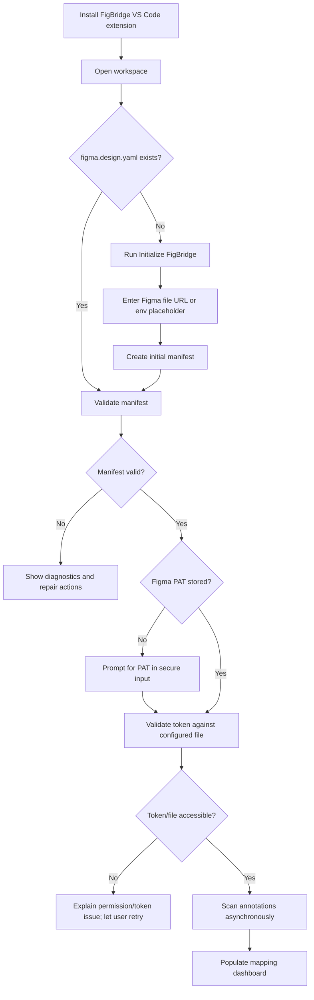
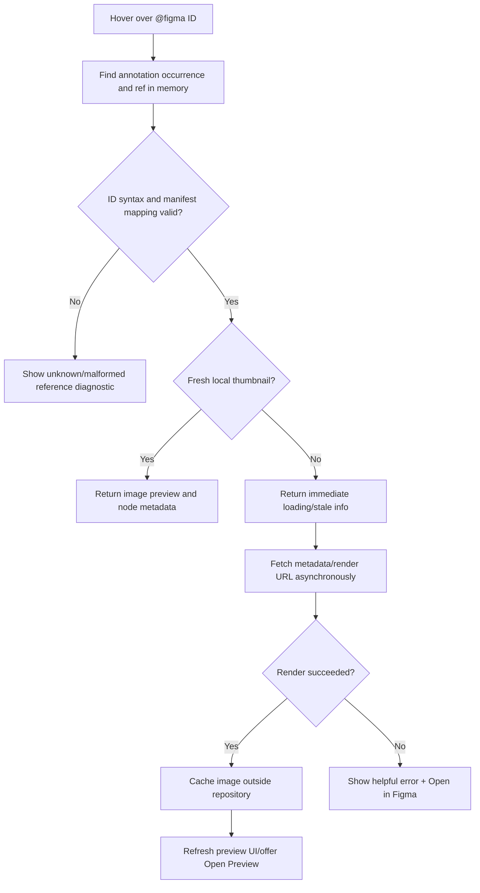
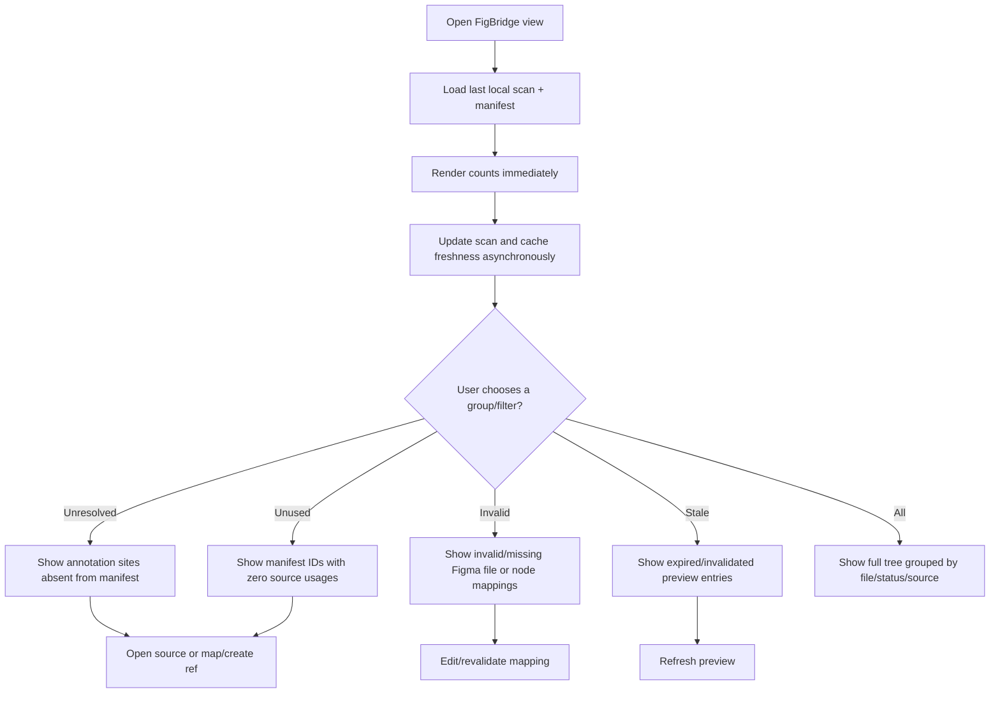
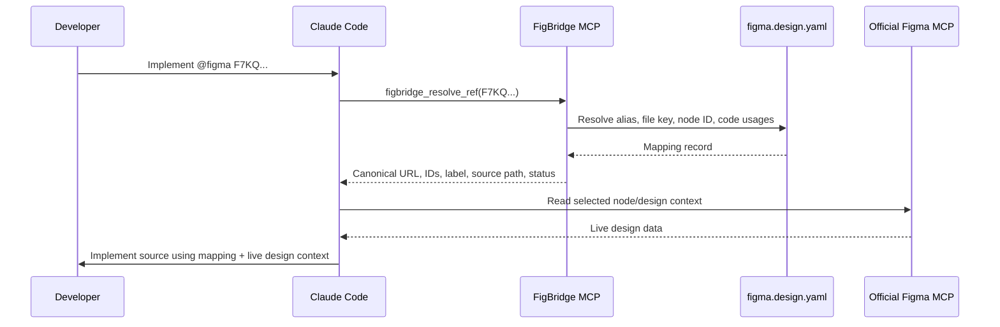

# 03 — Application Flows

This document describes the app behavior from the perspective of a developer. “Frame” means a Figma node selected as a screen/section/component. “Reference” means an opaque ID in code backed by the repository manifest.

## 1. First-run setup



### Required behavior
- Initialization must never overwrite an existing manifest without confirmation.
- Users can initialize the config without a PAT; local annotations can still be scanned offline.
- PAT input must be masked and stored in SecretStorage.
- Validation should call the smallest safe API endpoint and not fetch full file content unless required.
- Environment placeholders should name the exact missing variable and never dump environment contents.

## 2. Adding a design annotation

```mermaid
sequenceDiagram
  participant Dev as Developer
  participant IDE as VS Code / FigBridge
  participant Core as FigBridge Core
  participant Figma as Figma REST API
  Dev->>IDE: Run Create Design Reference / paste Figma URL
  IDE->>Core: Parse URL and validate host/file/node
  Core->>Figma: Request node/file metadata (if authenticated)
  Figma-->>Core: Node metadata or access/error response
  Core->>Core: Generate collision-checked opaque ID
  Core-->>IDE: Proposed manifest entry + annotation
  IDE-->>Dev: Preview diff; ask placement/file confirmation
  Dev->>IDE: Confirm
  IDE->>Core: Write manifest entry and annotation at chosen location
  Core->>Core: Validate manifest and update index
  IDE-->>Dev: Show resolved status and available preview
```

The first release may support manual ID creation/editing in YAML if automated insertion is too expensive; nevertheless the grammar and ID generator should be finalized before general use. Automated annotation insertion must use a `WorkspaceEdit` and show the exact proposed changes.

### Manual route
1. User selects/pastes Figma URL.
2. FigBridge normalizes file key and node ID.
3. `figbridge generate-id` creates a 12-character ID.
4. The manifest entry is added to `refs`.
5. The extension provides a code comment template.
6. User places it above the relevant source declaration.
7. Scanner resolves mapping and shows status.

### Figma URL rules
- If URL has no node ID, FigBridge can create a file mapping but must ask the user to select a node before creating a per-component reference.
- Figma node IDs are not assumed to be sequential, stable across delete/recreate, or guessable.
- If a linked node disappears, mark the reference invalid; do not auto-map to a similarly named node.

## 3. Hover preview flow



The implementation must not make network latency part of the synchronous hover response. If VS Code does not reliably re-render Markdown hover contents after fetch, it should keep hover text minimal and expose `FigBridge: Preview Reference` as a quick-look command backed by a Webview.

## 4. Open exact Figma node

1. User clicks/executes Open in Figma from CodeLens, hover command, dashboard row, or command palette.
2. Resolver produces canonical file URL and URL-safe selected-node query.
3. Extension invokes VS Code's external URI opener.
4. OS/browser or the user's Figma URL handling opens the design.
5. Extension records a user-level “opened” action only in session UI if useful; it does not send analytics.

The extension must not assert that it can force the official Figma VS Code extension's internal view to open a specific node. The fallback browser URL is required; a documented development-resource link can optionally be used for cross-navigation.

## 5. Dashboard audit flow



Counts must include timestamp/coverage state. If scanning only some workspace folders/languages is possible, show “scan incomplete” and do not represent unseen refs as unused.

## 6. Claude reads a reference



The two MCP servers have different responsibilities. FigBridge resolves project-local identifiers; official Figma MCP provides live design context and, where permitted, writes design changes. If the mapping is unresolved, Claude should stop and request correction rather than search all frames by name and silently choose one.

## 7. Claude changes a Figma design

```mermaid
sequenceDiagram
  participant Claude as Claude Code
  participant FMCP as Official Figma MCP
  participant Hook as PostToolUse hook
  participant Events as Local event spool
  participant IDE as FigBridge extension
  participant API as Figma REST API
  Claude->>FMCP: Mutate a frame/component
  FMCP-->>Claude: Tool result
  Claude->>Hook: Hook receives tool name/input/output
  Hook->>Hook: Filter Figma tool, minimize and validate event
  Hook->>Events: Write local event record
  IDE->>Events: Detect new event
  IDE->>IDE: Mark known target stale or conservatively invalidate file cache
  IDE-->>Claude: No action required; developer sees stale/updated state
  IDE->>API: Refresh node metadata/render when requested or visible
  API-->>IDE: Latest rendered image/metadata
  IDE->>IDE: Update cache and dashboard
```

### Event handling semantics
- A `PostToolUse` hook is evidence that a tool invocation completed; it is not a proof of semantic correctness or a global Figma synchronization event.
- If the output has a clear file and node ID, invalidate that node and its dependents.
- If the file is clear but node is not, invalidate that file's references.
- If neither is clear but tool name is known to be a Figma mutation, mark configured previews `possibly stale` and offer refresh.
- If hook payload cannot be parsed, ignore it safely and show a diagnostic only when debugging is enabled.
- Read-only Figma MCP calls must not be misclassified as mutations.

## 8. Token expiry/offline flow

- If API returns 401/403, preserve cached preview, show stale/offline state and offer secure token replacement.
- PAT is never written back to `.env` or config.
- When offline, local scan and manifest validation continue. Remote reference validation is “unknown/offline”, not “invalid”.
- On reconnect, retry only on demand or through a bounded background sync; do not hammer the API.

## 9. Config changes and Git workflow

1. User edits `figma.design.yaml` or switches Git branch.
2. File watcher observes content/version change.
3. Parse and validate new version in memory before swapping the last-known-good config.
4. If valid, rebuild indexes and invalidate cache only for changed mappings.
5. If invalid, preserve last-known-good view but flag configuration as stale and show diagnostics; never write an auto-corrected manifest without user consent.
6. On branch switch, mappings from the checked-out manifest become authoritative, while preview cache can be reused by `(fileKey,nodeId,version)`.

## 10. Future Dev Mode plugin flow

This is out of MVP scope, but API boundaries should support it:
- User selects a Figma node in Dev Mode.
- Plugin extracts file key/node ID from supported plugin APIs/selection context.
- User copies a reference ID or requests a mapping.
- If a configured local bridge exists, it can return code paths; otherwise the plugin can create/copy only a normalized design URL/reference metadata.
- It must not assume a Figma plugin can read a user's local repository directly.

## 11. Future browser extension flow

A browser extension can parse the current Figma page URL and offer “Copy FigBridge reference” / “Open code mapping”, but it cannot directly access VS Code SecretStorage. Any local communication requires explicit opt-in, origin restrictions, and a local protocol or native messaging host. This is why a browser extension is deferred.
